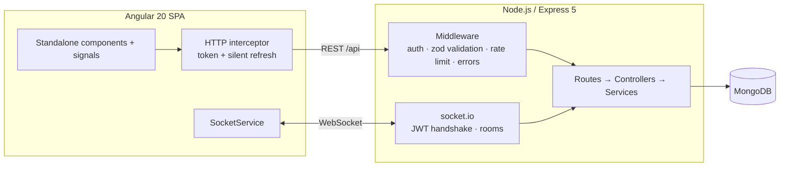
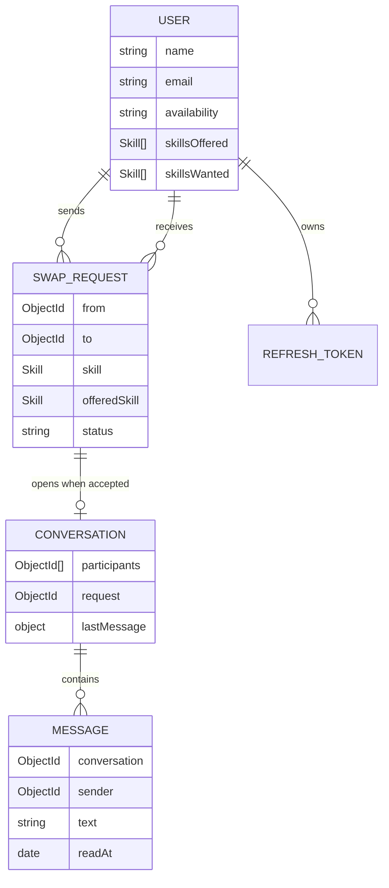

# ⇄ SkillSwap

**Trade what you know for what you want to learn.** SkillSwap is a full-stack peer-to-peer
skill-exchange platform. People list the skills they can teach and the skills they want to learn,
find each other, send swap requests, and chat in real time once a request is accepted.


> 🔗 **Live demo:** _coming soon_ · Use **“Try the demo account”** on the login page.

<!-- Screenshots: add images to docs/ and reference them here -->
<!--   -->

---

## ✨ Features

| Area | What it does |
| --- | --- |
| **Auth** | Register and log in. Short-lived JWT access token (kept in memory) plus a rotating refresh token in an httpOnly cookie. The client refreshes silently on 401. Reusing a refresh token revokes all of that user's sessions. |
| **Profiles** | Bio, avatar, location, online/in-person availability, languages, and skills offered and wanted (name, category, level). Public profile pages highlight skills that match yours. |
| **Explore** | Full-text search (MongoDB text index) with filters for teach/want, category, level, online/in-person and city, plus pagination and loading skeletons. |
| **Swap requests** | Request a specific skill and optionally offer one of yours in return. Self-requests and duplicate pending requests are blocked (checked in code and by a partial unique index). Received and sent inboxes with accept, decline and cancel. |
| **Real-time chat** | Accepting a request opens a private room. Socket connections are JWT-authenticated and only participants can join. Messages persist in MongoDB with cursor pagination. Includes typing indicators, read receipts (✓ / ✓✓), online presence, unread badges and live toasts. |

### Roadmap
- **Smart matching:** rank mutual swaps (A teaches what B wants and B teaches what A wants) with an aggregation pipeline
- **Sessions:** schedule swap sessions and have both people confirm completion
- **Time credits:** teach 1 hour to earn 1 credit and spend credits to learn, with transfers done in MongoDB transactions
- **Reviews and reputation**, plus **real-time notifications**

---

## 🏗️ Architecture



**Monorepo layout**

```
client/                     Angular app
  src/app/core/             models, services, guards, interceptors
  src/app/features/         auth, home, explore, profile, requests, chat
  src/app/shared/           reusable UI components and pipes
server/                     Express API + socket.io
  src/routes → controllers → services → models
  src/middleware/           auth, validate (zod), rateLimit, errorHandler
  src/sockets/              socket auth, rooms, presence, emitter
  src/validators/           zod schemas
  scripts/seed.js           demo data (20 users with overlapping skills)
  tests/                    Jest + Supertest (in-memory MongoDB)
```

### Data model



---

## 🧠 Key design decisions

- **Token strategy.** The access token (15 min) lives only in memory, so injected scripts can't read it from `localStorage`. The refresh token is an opaque random string in an `httpOnly` cookie scoped to `/api/auth`, and only its SHA-256 hash is stored. Every refresh **rotates** the token. Presenting an already-used token is treated as theft, and all of that user's sessions are revoked.
- **Silent refresh.** The interceptor catches a 401, refreshes once and retries the request. Concurrent requests share a single refresh call (`shareReplay`), so a burst of 401s doesn't cause a burst of refreshes.
- **Socket auth.** The socket.io handshake must carry a valid access token. Each user joins a private `user:<id>` room (for request and inbox events). Joining a `conversation:<id>` room is checked against the database, and typing events are only relayed to rooms the socket was allowed into.
- **Race-safe state changes.** Accept, decline and cancel use a conditional `findOneAndUpdate({ status: 'pending' })`, so two clicks can't both succeed. Duplicate pending requests are blocked by a **partial unique index**, not just an application-level check.
- **Optimistic chat.** Sent messages appear immediately and are replaced by the saved copy when the server acknowledges them, de-duplicated against the broadcast echo.
- **Consistent API.** Every response is `{ success, data, meta? }` or `{ success: false, error: { code, message, details? } }`, produced by one central error handler.

---

## 🔌 API

All routes are under `/api`. 🔒 = requires `Authorization: Bearer <accessToken>`.

| Method | Endpoint | Description |
| --- | --- | --- |
| POST | `/auth/register` | Create an account (sets refresh cookie) |
| POST | `/auth/login` | Log in (sets refresh cookie) |
| POST | `/auth/refresh` | Rotate the refresh cookie and get a new access token |
| POST | `/auth/logout` | Revoke the refresh token |
| GET 🔒 | `/auth/me` | Current user |
| GET | `/users/meta` | Skill categories and levels |
| GET 🔒 | `/users` | Explore: `q, type, category, level, availability, city, page, limit` |
| GET/PATCH 🔒 | `/users/me` | Read or update my profile |
| GET 🔒 | `/users/:id` | Public profile |
| POST 🔒 | `/requests` | Send a swap request `{ to, skillId, offeredSkillId?, message? }` |
| GET 🔒 | `/requests` | Inbox: `box=received\|sent, status, page` |
| PATCH 🔒 | `/requests/:id/:action` | `accept` · `decline` · `cancel` |
| GET 🔒 | `/conversations` | My chats with unread counts |
| GET 🔒 | `/conversations/:id` | One conversation |
| GET 🔒 | `/conversations/:id/messages` | History, cursor-paginated: `before, limit` |
| POST 🔒 | `/conversations/:id/messages` | Send a message (REST fallback) |
| POST 🔒 | `/conversations/:id/read` | Mark the conversation as read |

**Socket events:** `conversation:join`, `conversation:leave`, `message:send`, `message:read`,
`typing`, `presence:query` (client → server); `message:new`, `message:read`, `typing`,
`conversation:updated`, `request:new`, `request:updated`, `presence:update` (server → client).

---

## 🚀 Getting started

### Prerequisites
- Node.js 20+ and npm
- MongoDB 7+ running locally (or a MongoDB Atlas connection string)

### 1. API
```bash
cd server
cp .env.example .env      # then set JWT_ACCESS_SECRET
npm install
npm run seed              # optional: 20 demo users + sample requests and chat
npm run dev               # http://localhost:4000
```

### 2. Client
```bash
cd client
npm install
npm start                 # http://localhost:4200 (proxies /api and /socket.io to :4000)
```

Demo login: **demo@skillswap.dev / password123** (or click “Try the demo account”).

### Docker (whole stack)
```bash
docker compose up --build                       # http://localhost:8080
docker compose exec server node scripts/seed.js # demo data
```

### Tests
```bash
cd server && npm test     # Jest + Supertest against an in-memory MongoDB replica set
cd client && npm test     # Angular unit tests (Karma/Jasmine)
```

---

## ⚙️ Environment variables (`server/.env`)

| Variable | Example | Notes |
| --- | --- | --- |
| `PORT` | `4000` | |
| `MONGO_URI` | `mongodb://127.0.0.1:27017/skillswap` | |
| `CLIENT_URL` | `http://localhost:4200` | CORS origin and socket.io origin |
| `JWT_ACCESS_SECRET` | long random string | `node -e "console.log(require('crypto').randomBytes(32).toString('hex'))"` |
| `JWT_ACCESS_EXPIRES_IN` | `15m` | |
| `JWT_REFRESH_EXPIRES_DAYS` | `7` | |
| `COOKIE_SAMESITE` | `lax` | Use `none` when the client and API are on different domains |
| `COOKIE_SECURE` | `false` | Must be `true` with `SameSite=None` (HTTPS) |

---

## ☁️ Deployment

1. **Database:** create a free MongoDB Atlas cluster and copy the connection string.
2. **API on Render or Railway:** root `server/`, build `npm ci`, start `npm start`. Set the env vars above with `CLIENT_URL=https://<your-client>`, `COOKIE_SAMESITE=none` and `COOKIE_SECURE=true`.
3. **Client on Vercel or Netlify:** set `apiUrl` and `socketUrl` in `client/src/environments/environment.prod.ts` to your API URL. Build with `npm run build` and publish `dist/client/browser`. Add a SPA rewrite to `index.html`.
4. Run the seed once against Atlas: `MONGO_URI=<atlas-uri> npm run seed`.

---

Built by **[Your Name](https://github.com/your-username)** as a portfolio project · [LinkedIn](https://linkedin.com/in/your-profile)
