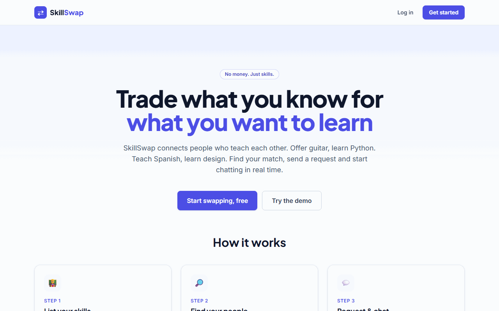
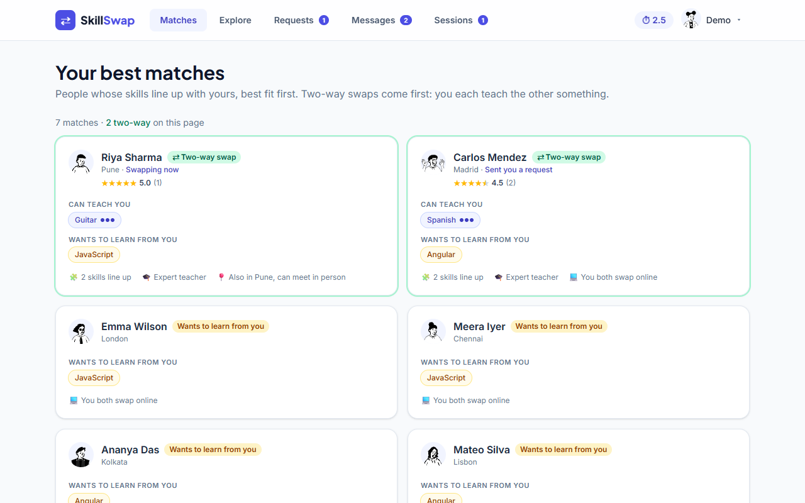
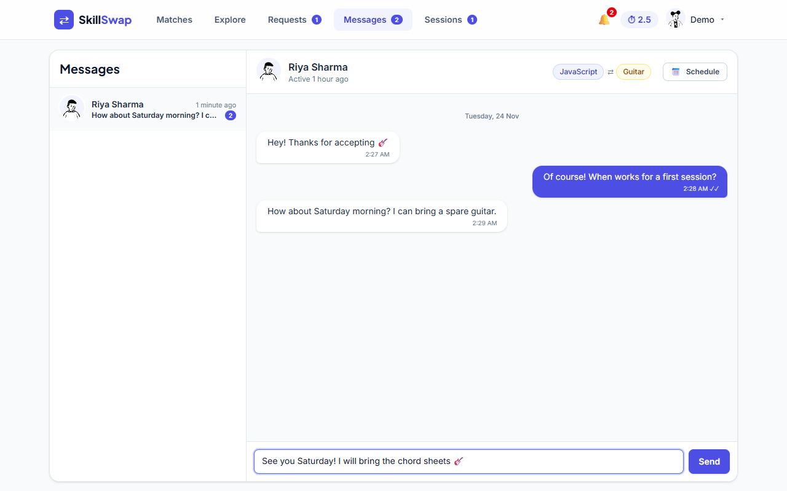
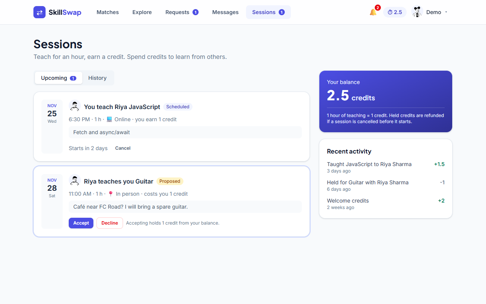
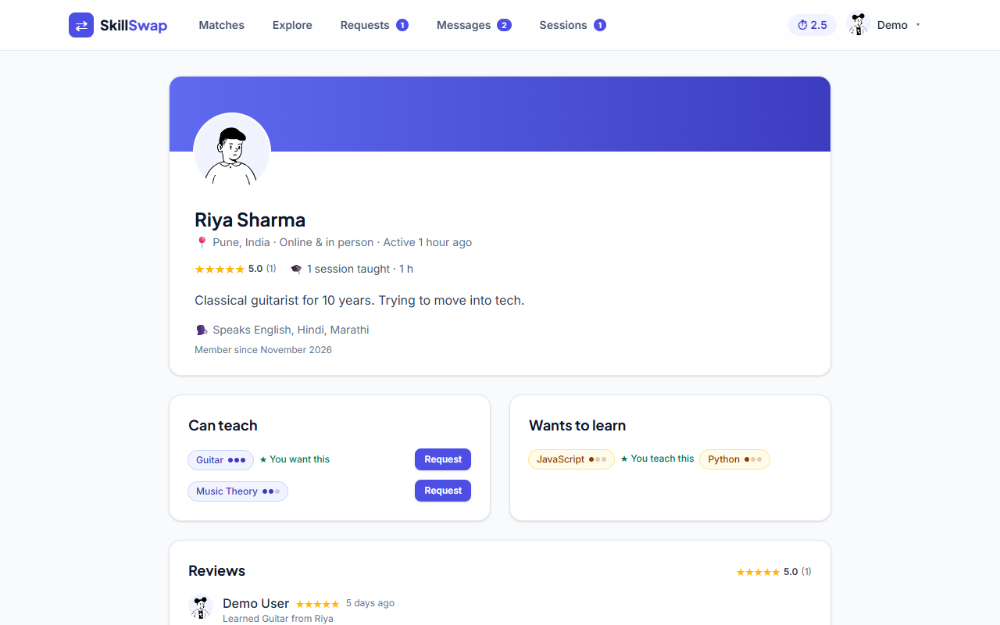
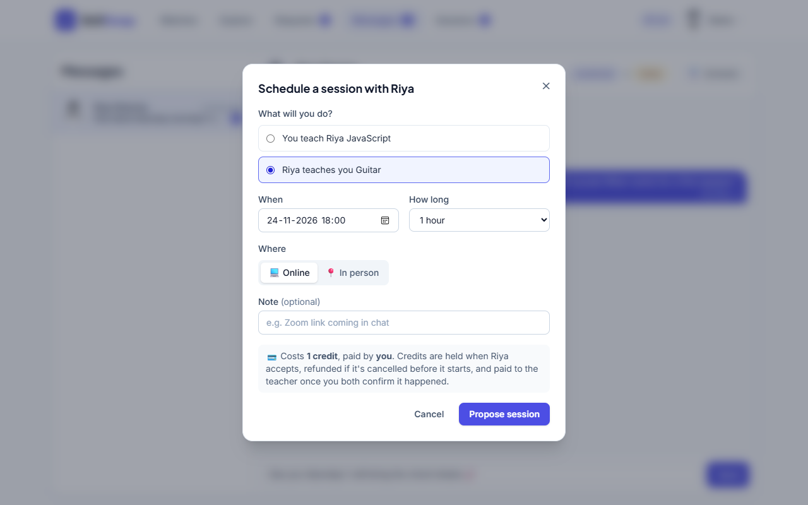
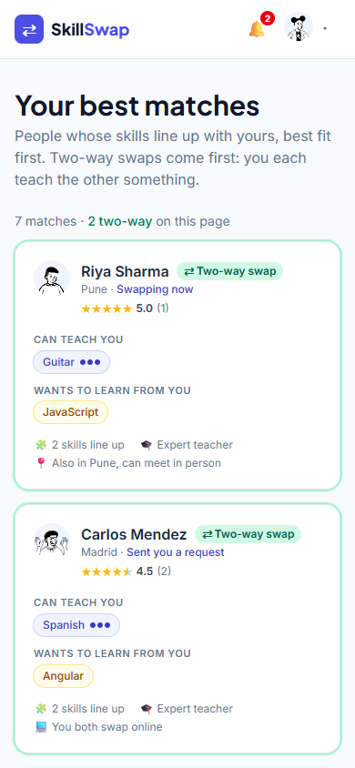
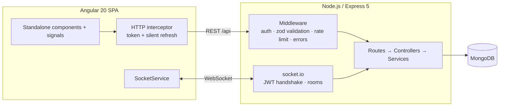
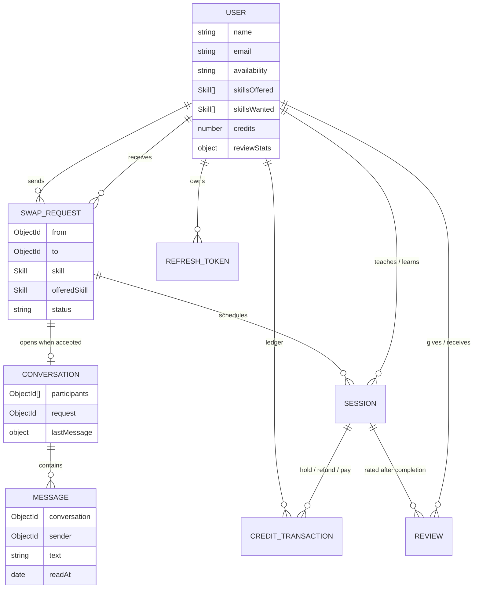

# ⇄ SkillSwap

**Trade what you know for what you want to learn.** SkillSwap is a full-stack peer-to-peer
skill-exchange platform. People list the skills they can teach and the skills they want to learn,
find each other, send swap requests, and chat in real time once a request is accepted.

[](https://github.com/aJoshiG/skillswap/actions/workflows/ci.yml)


> 🔗 **Live demo: [skillswap-7dfr.onrender.com](https://skillswap-7dfr.onrender.com)** · Click **“Try the demo account”** on the login page. (Free hosting: the first visit after a quiet spell can take ~50s to wake up.)

<p align="center">
  
</p>

| Smart matches | Real-time chat | Sessions & credits |
| --- | --- | --- |
|  |  |  |
| **Profile & reviews** | **Schedule a session** | **Mobile** |
|  |  |  |

---

## ✨ Features

| Area | What it does |
| --- | --- |
| **Auth** | Register and log in. Short-lived JWT access token (kept in memory) plus a rotating refresh token in an httpOnly cookie. The client refreshes silently on 401. Reusing a refresh token revokes all of that user's sessions. |
| **Profiles** | Bio, avatar, location, online/in-person availability, languages, and skills offered and wanted (name, category, level). Public profile pages highlight skills that match yours. |
| **Smart matching** | A ranked **Matches** page (where you land after logging in). One MongoDB aggregation pipeline finds people who teach what you want or want what you teach, case-insensitively, and puts two-way swaps first. Ranking also weighs how many skills overlap, the teacher's level, and whether you can meet in person in the same city or online. Each card explains *why* you matched and shows any open swap between you. |
| **Explore** | Full-text search (MongoDB text index) with filters for teach/want, category, level, online/in-person and city, plus pagination and loading skeletons. |
| **Swap requests** | Request a specific skill and optionally offer one of yours in return. Self-requests and duplicate pending requests are blocked (checked in code and by a partial unique index). Received and sent inboxes with accept, decline and cancel. |
| **Real-time chat** | Accepting a request opens a private room. Socket connections are JWT-authenticated and only participants can join. Messages persist in MongoDB with cursor pagination. Includes typing indicators, read receipts (✓ / ✓✓), online presence, unread badges and live toasts. |
| **Sessions & time credits** | Schedule lessons from an accepted swap (in chat or on the Requests page): who teaches what, when, how long, online or in person. 1 hour of teaching = 1 credit, and new users start with 2. Accepting a session **holds** the learner's credits (escrow). Cancelling before it starts **refunds** them. Once both people confirm it happened, the teacher is **paid**. Every step runs in a **MongoDB transaction** and is written to an append-only ledger. Live updates over the socket, plus a navbar balance and an action badge. |
| **Reviews & reputation** | After a completed session, both people can rate each other (1–5 stars, optional comment), once per session. Profiles show the average rating, sessions and hours taught, and the reviews. Explore and Matches cards show ratings, and **Matches ranks better-rated teachers higher** using a Bayesian average. Reviewees get a live notification. The star picker is accessible: real radio buttons, keyboard and screen readers. |

### Roadmap
- **Real-time notifications** center (beyond the current live toasts)
- Auto-resolve sessions nobody confirms (e.g. refund after 7 days)

---

## 🏗️ Architecture



**Monorepo layout**

```
client/                     Angular app
  src/app/core/             models, services, guards, interceptors
  src/app/features/         auth, home, explore, profile, requests, chat
  src/app/shared/           reusable UI components and pipes
server/                     Express API + socket.io
  src/routes → controllers → services → models
  src/middleware/           auth, validate (zod), rateLimit, errorHandler
  src/sockets/              socket auth, rooms, presence, emitter
  src/validators/           zod schemas
  scripts/seed.js           demo data (20 users with overlapping skills)
  tests/                    Jest + Supertest (in-memory MongoDB)
```

### Data model



---

## 🧠 Key design decisions

- **Token strategy.** The access token (15 min) lives only in memory, so injected scripts can't read it from `localStorage`. The refresh token is an opaque random string in an `httpOnly` cookie scoped to `/api/auth`, and only its SHA-256 hash is stored. Every refresh **rotates** the token. Presenting an already-used token is treated as theft, and all of that user's sessions are revoked. The exception is a **30-second grace period** right after rotation: if a page reloads mid-refresh, the browser never stores the new cookie and resends the old one. Testing on the live deploy caught this, since it only shows up with real network latency.
- **Silent refresh.** The interceptor catches a 401, refreshes once and retries the request. Concurrent requests share a single refresh call (`shareReplay`), so a burst of 401s doesn't cause a burst of refreshes.
- **Socket auth.** The socket.io handshake must carry a valid access token. Each user joins a private `user:<id>` room (for request and inbox events). Joining a `conversation:<id>` room is checked against the database, and typing events are only relayed to rooms the socket was allowed into.
- **Race-safe state changes.** Accept, decline and cancel use a conditional `findOneAndUpdate({ status: 'pending' })`, so two clicks can't both succeed. Duplicate pending requests are blocked by a **partial unique index**, not just an application-level check.
- **Optimistic chat.** Sent messages appear immediately and are replaced by the saved copy when the server acknowledges them, de-duplicated against the broadcast echo.
- **Matching in one aggregation pipeline.** `$match` (candidates) → `$addFields` (overlapping skills in each direction, meeting formats, score) → `$sort` → `$facet` (page + total in one round trip) → `$lookup` (open swaps, only for the page shown). The candidate filter uses case-insensitive **collation-aware indexes** on skill names, so it examines only real matches instead of scanning every user (checked with `explain()`).
- **Credits are money-like, so every move is a transaction.** Holding, refunding and paying each update the balance (`User.credits`), the ledger (`CreditTransaction`) and the session status inside one MongoDB transaction: all or nothing. Spending is a conditional update ("only if the balance is at least this much"), so balances never go negative. Status changes are conditional too (`scheduled → completed` happens once), so the teacher is paid exactly once. Tests fire simultaneous accepts and confirms; MongoDB detects the write conflicts and retries, and the results stay correct. The ledger always adds up to the balance, and the tests check that.
- **Reputation without race conditions or rating spam.** A review and the reviewee's stats (`$inc` on count and sum) are written in one transaction, so concurrent reviews can't lose updates. A unique index on (session, reviewer) rejects a second review, even one submitted at the same moment. Matching uses a **Bayesian average**: `(sum + 4×3) / (count + 3)` pulls ratings with few reviews toward a neutral prior, so one lucky 5★ doesn't outrank a teacher with twenty 4.8s, and new users aren't penalised. Teaching stats (sessions and hours) are computed from completed sessions, the source of truth, rather than stored counters.
- **Consistent API.** Every response is `{ success, data, meta? }` or `{ success: false, error: { code, message, details? } }`, produced by one central error handler.

---

## 🔌 API

All routes are under `/api`. 🔒 = requires `Authorization: Bearer <accessToken>`.

| Method | Endpoint | Description |
| --- | --- | --- |
| POST | `/auth/register` | Create an account (sets refresh cookie) |
| POST | `/auth/login` | Log in (sets refresh cookie) |
| POST | `/auth/refresh` | Rotate the refresh cookie and get a new access token |
| POST | `/auth/logout` | Revoke the refresh token |
| GET 🔒 | `/auth/me` | Current user |
| GET | `/users/meta` | Skill categories and levels |
| GET 🔒 | `/users` | Explore: `q, type, category, level, availability, city, page, limit` |
| GET/PATCH 🔒 | `/users/me` | Read or update my profile |
| GET 🔒 | `/users/matches` | Smart matching: ranked matches with reasons and open swaps, `page, limit` |
| GET 🔒 | `/users/:id` | Public profile |
| POST 🔒 | `/requests` | Send a swap request `{ to, skillId, offeredSkillId?, message? }` |
| GET 🔒 | `/requests` | Inbox: `box=received\|sent, status, page` |
| PATCH 🔒 | `/requests/:id/:action` | `accept` · `decline` · `cancel` |
| GET 🔒 | `/conversations` | My chats with unread counts |
| GET 🔒 | `/conversations/:id` | One conversation |
| GET 🔒 | `/conversations/:id/messages` | History, cursor-paginated: `before, limit` |
| POST 🔒 | `/conversations/:id/messages` | Send a message (REST fallback) |
| POST 🔒 | `/conversations/:id/read` | Mark the conversation as read |
| POST 🔒 | `/sessions` | Propose a session `{ requestId, skill: requested\|offered, scheduledAt, durationMinutes, mode, note? }` |
| GET 🔒 | `/sessions` | My sessions: `scope=active\|history, page, limit` |
| POST 🔒 | `/sessions/:id/review` | Review the other person on a completed session `{ rating: 1–5, comment? }` |
| GET 🔒 | `/users/:id/reviews` | Reviews a user received, `page, limit` |
| PATCH 🔒 | `/sessions/:id/:action` | `accept` (holds credits) · `decline` · `cancel` (refunds) · `confirm` (pays when both have) |
| GET 🔒 | `/credits` | Balance, held credits and the ledger, `page, limit` |

**Socket events:** `conversation:join`, `conversation:leave`, `message:send`, `message:read`,
`typing`, `presence:query` (client → server); `message:new`, `message:read`, `typing`,
`conversation:updated`, `request:new`, `request:updated`, `session:updated`, `review:new`, `presence:update` (server → client).

---

## 🚀 Getting started

### Prerequisites
- Node.js 20+ and npm
- MongoDB: sessions and credits use **transactions**, which need a **replica set**. Atlas and Docker Compose already are one. Locally, `npm run db` (below) starts one for you on port 27018, with no admin rights or system changes needed.

### 1. API
```bash
cd server
cp .env.example .env      # then set JWT_ACCESS_SECRET
npm install
npm run db                # terminal 1: local MongoDB replica set on :27018 (data in server/.data)
npm run seed              # terminal 2: 20 demo users, requests, chat, sessions and credits
npm run dev               # http://localhost:4000
```

### 2. Client
```bash
cd client
npm install
npm start                 # http://localhost:4200 (proxies /api and /socket.io to :4000)
```

Demo login: **demo@skillswap.dev / password123** (or click “Try the demo account”).

### Docker (whole stack)
```bash
docker compose up --build                       # http://localhost:8080
docker compose exec server node scripts/seed.js # demo data
```

### Tests
```bash
cd server && npm test     # Jest + Supertest against an in-memory MongoDB replica set
cd client && npm test     # Angular unit tests (Karma/Jasmine)
cd e2e && npm test        # Playwright end-to-end + axe accessibility (needs: client built)
```

The **end-to-end suite** starts everything from scratch: an in-memory MongoDB replica set, the demo seed, and the real server in production mode serving the built app. Then it drives real browsers through every main flow: sign-up to matches, two-person real-time chat, the credits lifecycle (hold, confirm, pay, refund), keyboard-only reviews, and **axe-core WCAG 2.1 AA checks** on every page and dialog. CI runs it on every push. `npm run screenshots` in `e2e/` regenerates the images in this README.

---

## ⚙️ Environment variables (`server/.env`)

| Variable | Example | Notes |
| --- | --- | --- |
| `PORT` | `4000` | |
| `MONGO_URI` | `mongodb://127.0.0.1:27018/skillswap?replicaSet=rs0` | Must be a replica set for sessions/credits (`npm run db`, Atlas, or Docker Compose) |
| `CLIENT_URL` | `http://localhost:4200` | CORS origin and socket.io origin (on Render, defaults to the service URL) |
| `CLIENT_DIST` | `client/dist/client/browser` | Built Angular app to serve; defaults to that path when `NODE_ENV=production` |
| `JWT_ACCESS_SECRET` | long random string | `node -e "console.log(require('crypto').randomBytes(32).toString('hex'))"` |
| `JWT_ACCESS_EXPIRES_IN` | `15m` | |
| `JWT_REFRESH_EXPIRES_DAYS` | `7` | |
| `COOKIE_SAMESITE` | `lax` | Use `none` when the client and API are on different domains |
| `COOKIE_SECURE` | `false` | Must be `true` with `SameSite=None` (HTTPS) |

---

## ☁️ Deployment

SkillSwap deploys as **one service**: in production, Express serves the built Angular app as well as
the API and socket.io. Everything shares one origin, so there are no cross-site cookies, CORS or
WebSocket-proxy settings to manage.

1. **Database:** create a free MongoDB Atlas cluster, a database user, and allow network access.
2. **Render:** *New → Blueprint* → select this repo. [`render.yaml`](render.yaml) defines the service
   (build `npm run build`, start `npm start`, health check `/api/health`). Enter `MONGO_URI` when asked;
   `JWT_ACCESS_SECRET` is generated for you.
3. **Demo data:** put `MONGO_URI=<atlas-uri>` in `server/.env.atlas` (git-ignored), then run
   `npm run seed:atlas` from `server/`.

The free Render tier sleeps after ~15 minutes idle, so the first visit after a while takes ~30–60s to wake up.

---

Built by **[aJoshiG](https://github.com/aJoshiG)** as a portfolio project.
